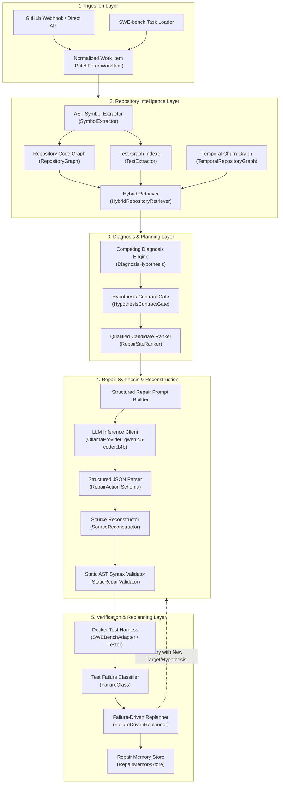
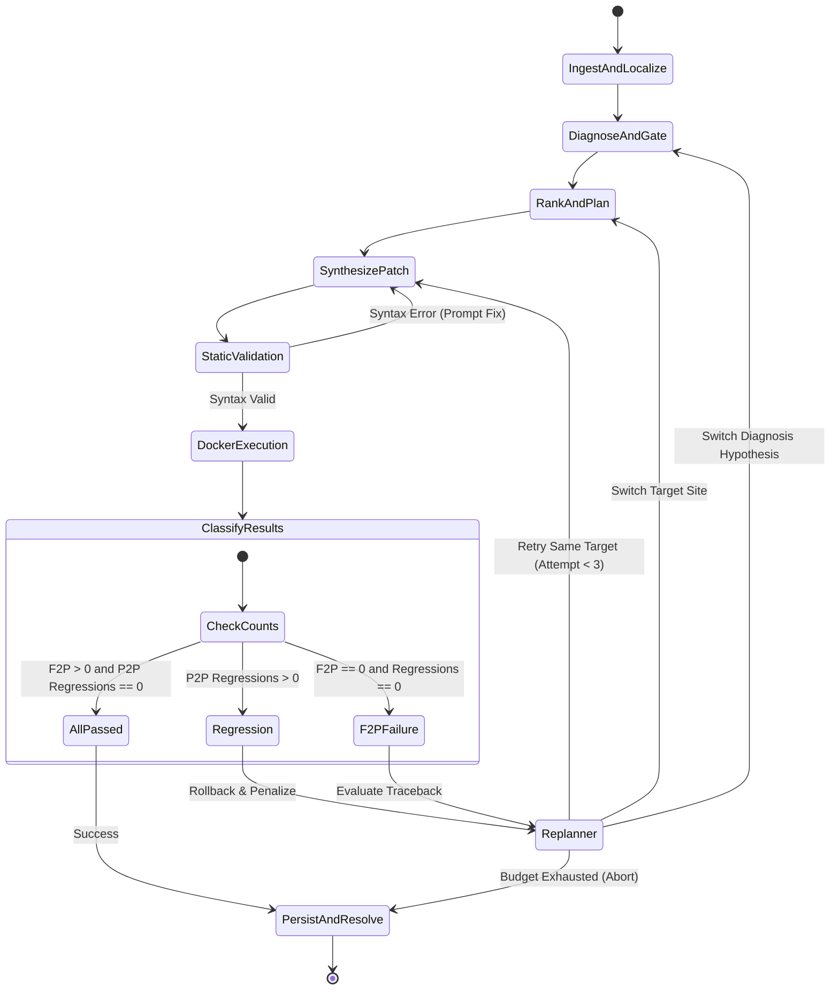

# PatchForge AI — System Architecture & Execution Design

## 1. High-Level Architecture Overview

PatchForge AI is structured into decoupled functional layers, separating static program analysis from LLM reasoning, code synthesis, containerized test execution, and persistence.

---

## 2. Stage-by-Stage Pipeline Specifications

| Pipeline Stage | Module & Class | Primary Inputs | Primary Outputs | Failure / Error Path |
|:---|:---|:---|:---|:---|
| **1. Input Ingestion** | `patchforge.integrations.work_item` (`PatchForgeWorkItem`) | Raw JSON, issue dict, or webhook body | Validated `PatchForgeWorkItem` | Rejects payload on path traversal (`..` or abs path) or missing keys. |
| **2. Repo Indexing** | `patchforge.repository_intelligence.indexer` (`RepositoryIndexer`) | Target repository path | Symbol tables, class definitions, function boundaries | Gracefully skips unparseable or binary files with syntax error logs. |
| **3. Code & Test Graph** | `patchforge.repository_intelligence.graph` & `test_graph` | AST symbols & test files | Directed graph of calls/defines; mapping of test assertions to symbols | Fallback to file-level associations if AST call resolution is ambiguous. |
| **4. Hybrid Retrieval** | `patchforge.retrieval.hybrid` (`HybridRepositoryRetriever`) | Work item text, repo index, test failure traces | Ranked list of `RetrievedCandidate` locations | Returns top lexical BM25 candidates if AST/trace signals are missing. |
| **5. Competing Diagnosis** | `patchforge.diagnosis.diagnosis` (`CompetingDiagnosisResult`) | Candidates, problem statement, failure trace | Ranked list of `DiagnosisHypothesis` with causal traces | Defaults to single observational hypothesis if reasoning is indeterminate. |
| **6. Contract Gate** | `patchforge.diagnosis.contract_gate` (`HypothesisContractGate`) | Hypotheses, API parameters, Behavioral requirements | Selected hypothesis & contract validation matrix | Preserves Primary Diagnosis hypothesis unless counterfactual score > 0.8. |
| **7. Qualified Ranking** | `patchforge.repair.ranking` (`RepairSiteRanker`) | Candidate edit sites, selected hypothesis | Qualified `RepairTarget` list (`file::class::func::target`) | Deterministic tie-breaking on file path and line span if scores match. |
| **8. Structured Repair** | `patchforge.repair.structured_repair` (`StructuredRepairPromptBuilder`) | Target code span, contract, hypothesis | Prompt string sent to Ollama LLM provider | Retries with simplified prompt if LLM times out (default 120s limit). |
| **9. JSON Parsing** | `patchforge.repair.structured_repair` (`StructuredRepairParser`) | Raw LLM output string | Validated `RepairAction` list | Regex-based markdown fence extractor handles conversational prefixes. |
| **10. Reconstruction** | `patchforge.repair.reconstructor` (`SourceReconstructor`) | Original file content, `RepairAction` list | Modified source code string | AST-guided span replacement; falls back to line-bounded string replacement. |
| **11. Static Validation** | `patchforge.repair.validator` (`StaticRepairValidator`) | Reconstructed source code | Boolean validity & syntax error messages | Immediately aborts candidate patch before Docker launch if `ast.parse` fails. |
| **12. Docker Execution** | `patchforge.integrations.swebench` (`SWEBenchAdapter`) | Candidate git diff, SWE-bench instance ID | Raw stdout, stderr, exit code, test counts | Subprocess timeout (300s) aborts container and logs `EXECUTION_TIMEOUT`. |
| **13. Classification** | `patchforge.verification.classifier` (`FailureClass`) | Harness execution output, F2P/P2P counts | Categorized `FailureClass` verdict | Classifies as `ALL_PASSED`, `F2P_FAILURE`, `P2P_REGRESSION`, or `WRONG_HYPOTHESIS`. |
| **14. Replanning** | `patchforge.repair.replanner` (`FailureDrivenReplanner`) | FailureClass, attempt count, residual state | `ReplanDecision` (`ACCEPT`, `RETRY`, `SWITCH_HYPOTHESIS`, `ABORT`) | Halts repair when max attempt budget (default 3) is reached. |
| **15. Persistence** | `patchforge.pipeline.v1_orchestrator` (`V1OrchestratorResult`) | Execution trajectory, patch, test results | Per-task JSON artifact in `results/v19_orchestrator/` | Writes atomic JSON file with run metadata and timing records. |

---

## 3. Data Flow vs. Control Flow

### Data Flow
1. **Raw Text / JSON** arrives from issue tracker or benchmark.
2. Ingestion parses this into a **`PatchForgeWorkItem`** containing `instance_id`, `repo`, `base_commit`, `problem_statement`, and `hints`.
3. Repo Intelligence converts source files into **`GraphNode`** and **`GraphEdge`** entities in memory.
4. Diagnosis converts retrieved nodes into **`DiagnosisHypothesis`** objects containing causal predictions.
5. The Contract Gate enriches hypotheses with **`BehavioralRequirementMatrix`** data.
6. The Ranker produces sorted **`RepairTarget`** objects containing qualified file, class, function, and edit span coordinates.
7. The LLM translates targeted context into a **`RepairAction`** payload (`type`, `target_code`, `replacement_code`).
8. The Reconstructor applies the action to produce a unified **`git diff`** patch string.
9. The Docker harness runs the patch and returns test execution logs, which the Classifier transforms into **`ExecutionEvidence`**.
10. The Orchestrator persists the entire execution trail into a permanent **`TaskArtifact`** JSON record.

### Control Flow & Retry Decision Matrix

---

## 4. State Management & Memory Isolation

- **In-Memory Ephemeral State**: Target graphs, AST caches, and temporary file trees are created in run-scoped sandboxes and cleaned up upon task completion.
- **`RepairMemoryStore`**: Maintains attempt signatures (SHA-256 hashes of applied diffs) to prevent cyclic re-generation of identical failed patches.
- **Workspace Isolation**: When executing locally or preparing diffs, PatchForge creates an isolated temporary working directory; production git state is never touched during task execution.
- **Single-Process Ingestion Idempotency**: `patchforge.integrations.github.IngestionIdempotencyTracker` maintains an in-memory sliding window of processed GitHub Delivery IDs. (Note: This is single-process and non-distributed; restarts reset the cache).

---

## 5. Security & Boundary Architecture

1. **Path Traversal Denial**:
   All paths passed to `PatchForgeWorkItem` and `DirectWorkItemIngestionHandler` are checked via `_validate_safe_path`:
   - Must not contain `..`
   - Must not be absolute (`/` or `C:\`)
   - Must resolve strictly within the designated workspace root.
2. **Webhook HMAC Validation**:
   GitHub webhook requests are verified using `hmac.compare_digest` with SHA-256 computed against the **raw binary request body** (`X-Hub-Signature-256`).
3. **Execution Sandboxing**:
   All benchmark test code runs inside ephemeral Docker containers without host network privileges, isolating the host environment from untrusted code execution.
