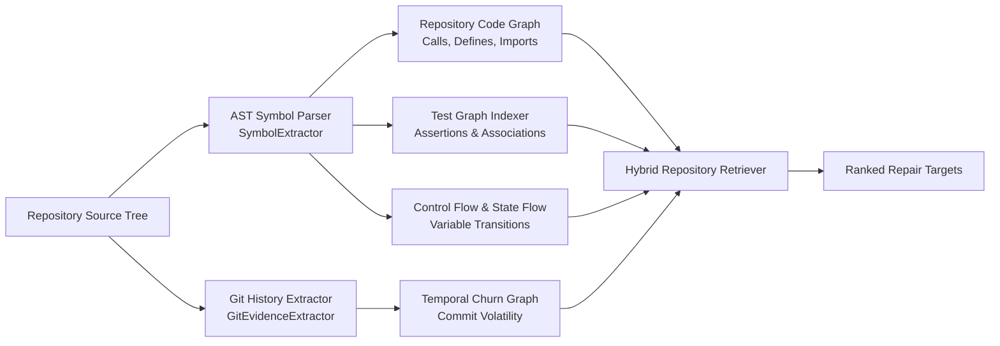

# PatchForge AI — Repository Intelligence & Static Analysis

PatchForge AI's repository intelligence layer bridges raw repository source files with reasoning models, extracting structured topological and behavioral signals before any repair attempts are synthesized.

---

## 1. Architecture of the Intelligence Layer

---

## 2. Component Descriptions

### A. AST Symbol Parsing (`SymbolExtractor`)
- **Module**: `patchforge.repository_intelligence.parser`
- Traverses Python ASTs (`ast.walk` and recursive visitors) to index:
  - Class definitions, bases, docstrings, and decorators.
  - Method and function definitions, parameter lists (args, kwargs, type annotations), and return expressions.
  - Global variable definitions and module-level constant assignments.
- Records exact starting and ending line spans (`lineno`, `end_lineno`), enabling byte-accurate span bounded patching.

### B. Repository Code Graph (`RepositoryGraph`)
- **Module**: `patchforge.repository_intelligence.graph`
- Uses `networkx.DiGraph` to model structural dependencies across the codebase:
  - **`NodeKind`**: `MODULE`, `CLASS`, `FUNCTION`, `METHOD`, `VARIABLE`.
  - **`EdgeKind`**:
    - `CALLS`: Function A invokes Function B.
    - `DEFINES`: Module defines Class, Class defines Method.
    - `IMPORTS`: File A imports Symbol from File B.
    - `INHERITS`: Class A subclasses Class B.
- Enables query operations such as:
  - Finding immediate callers and callees of a localized defect site.
  - Finding blast radius (all downstream functions affected by changing a function's return signature).

### C. Test Graph Indexer (`TestExtractor`)
- **Module**: `patchforge.repository_intelligence.test_graph`
- Analyzes test suites (e.g. `tests/test_*.py`):
  - Identifies test functions and fixtures.
  - Parses individual assertions (`assert ...`, `pytest.raises(...)`).
  - Resolves target production functions called within test bodies.
  - Maps test failure tracebacks directly back to target production symbols.

### D. Control Flow & State Flow (`ControlFlowBuilder`)
- **Module**: `patchforge.repository_intelligence.flow` & `patchforge.analysis.state_flow`
- Constructs intra-procedural Control Flow Graphs (CFGs) composed of `CFGBlock` nodes.
- Models variable definitions, uses, and re-assignments to detect unhandled exceptions, uninitialized branches, and missing default arguments.

### E. Temporal Churn Analysis (`TemporalRepositoryGraph`)
- **Module**: `patchforge.repository_intelligence.temporal_graph`
- Inspects Git commit history (`git log --numstat`):
  - Measures symbol churn: commit count, lines added/removed, unique authors per symbol.
  - Computes `SymbolTemporalProfile`: high-churn functions have a higher prior probability of harboring recent regression defects.

---

## 3. Hybrid Retrieval & Candidate Localization

**Module**: `patchforge.retrieval.hybrid` (`HybridRepositoryRetriever`)

Rather than relying purely on dense semantic vector embeddings or BM25 text search, PatchForge combines four distinct scoring signals:

$$\text{CandidateScore}(c) = w_{\text{lex}} S_{\text{lex}}(c) + w_{\text{ast}} S_{\text{ast}}(c) + w_{\text{test}} S_{\text{test}}(c) + w_{\text{graph}} S_{\text{graph}}(c)$$

1. **Lexical Relevance ($S_{\text{lex}}$)**: BM25 matching between the issue description / keywords and the symbol's name, docstring, and code body.
2. **AST Relevance ($S_{\text{ast}}$)**: Exact name and parameter token matches in symbol definitions.
3. **Test Correlation ($S_{\text{test}}$)**: Boosts candidates that appear in stack traces or are exercised by failing test assertions.
4. **Graph Proximity ($S_{\text{graph}}$)**: Penalizes symbols that are topologically isolated from observed failure symptoms.

---

## 4. Synergy in Target Localization

The combination of static AST intelligence and dynamic test graph traces creates a resilient localization funnel:
- Text search identifies relevant domain concepts in the problem statement.
- The test graph narrows the search to symbols executed by relevant test cases.
- The code graph identifies the root cause helper or adapter function rather than just the top-level API endpoint.
- Qualified naming (`file::class::func::target`) eliminates cross-file collisions between identical function names across different packages.
