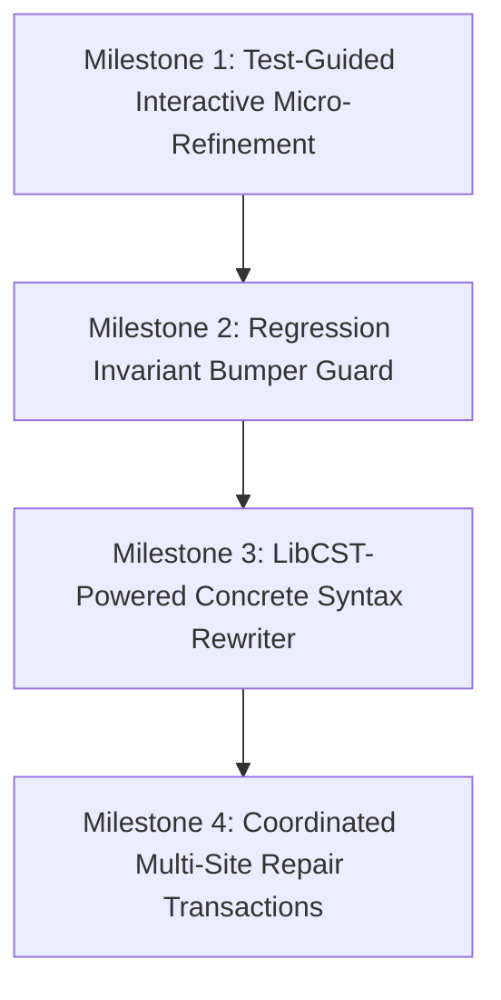

# PatchForge AI — Development Roadmap & V2.0 Priorities

This roadmap establishes the technical milestones, architectural priorities, acceptance criteria, and risk mitigations for the next generation of PatchForge AI (V2.0).

---

## 1. Roadmap Overview & Strategic Focus

Having stabilized the V1.9 pipeline (332 offline tests passing, 32/54 F2P tests passing, 97.0% P2P safety), future engineering must address the gap between **partial repair capability** and **full task resolution**.



---

## 2. Detailed Milestone Specifications

### Milestone 1: Test-Guided Interactive Micro-Refinement
- **Objective**: Solve multi-assertion incompleteness by decomposing repair into iterative assertion-level micro-steps rather than all-or-nothing function rewrites.
- **Architectural Change**:
  - Introduce `AssertionFailureExtractor`: extracts the exact failing expression and expected value from pytest output.
  - When an initial patch resolves 2 of 3 assertions, preserve the working diff and prompt the model *only* with the residual failing assertion:
    *"Assertion `assert response.status == 200` passed, but `assert response.headers['Retry-After'] == '120'` failed. Fortify only the header calculation without altering status logic."*
- **Acceptance Criteria**:
  - Unit tests verify `AssertionFailureExtractor` isolates single assertions from multiline pytest output.
  - Re-evaluating `psf__requests-2148` passes 3/3 F2P assertions.
- **Risk**: Overfitting to specific test assertion strings.

### Milestone 2: Regression Invariant Protection ("Bumper Guard")
- **Objective**: Enforce hard barriers against introducing regressions into passing tests (P2P).
- **Architectural Change**:
  - Implement `RegressionGuard`: If a candidate patch induces even 1 P2P regression, the patch is rejected immediately, and the exact regression traceback is fed to the replanner as a negative invariant constraint (*"Patch must not break existing test `test_custom_adapter_dispatch`"*).
  - Prevent the orchestrator from submitting regressed patches to the evaluation ledger.
- **Acceptance Criteria**:
  - P2P pass rate reaches 100.0% across the benchmark cohort.
- **Risk**: Rejecting valid candidate patches that exposed pre-existing brittle tests.

### Milestone 3: LibCST-Powered Concrete Syntax Rewriting
- **Objective**: Replace standard library `ast.parse` span matching with `libcst` (Concrete Syntax Tree).
- **Architectural Change**:
  - Replace `SourceReconstructor` heuristics with CST visitor transformations.
  - LibCST preserves all comments, whitespace, trailing commas, and formatting variations losslessly.
  - Generates perfectly formatted code without line-bounded string replacement fallbacks.
- **Acceptance Criteria**:
  - Zero syntax errors or indentation mismatches during patch reconstruction across all 20 benchmark tasks.
  - 100% preservation of file comments and formatting.
- **Risk**: Additional dependency (`libcst>=1.0.0`) and learning curve for CST visitor patterns.

### Milestone 4: Coordinated Multi-Site Repair Transactions
- **Objective**: Enable atomic multi-file edits for defects spanning multiple modules.
- **Architectural Change**:
  - Upgrade `RepairTarget` to support a `CompositeRepairTarget` holding multiple edit sites.
  - `StructuredRepairParser` accepts multiple file actions in a single response:
    ```json
    [
      {"file": "pylint/checkers/classes.py", "type": "REPLACE_BLOCK", ...},
      {"file": "pylint/utils/ast_walker.py", "type": "INSERT_BEFORE", ...}
    ]
    ```
  - Atomic validation: both files must pass syntax parsing before launching the test container.
- **Acceptance Criteria**:
  - Successfully resolves multi-file benchmark tasks (e.g. `pylint-dev__pylint-7228`).
- **Risk**: Exponential expansion of search space and LLM prompt context length.

---

## 3. Dependency Ordering & Execution Timeline

```
Phase 1: Diagnostic & Refinement Precision
  1.1 Implement AssertionFailureExtractor
  1.2 Implement MicroRefinementLoop in Replanner
  
Phase 2: Invariant & Safety Hardening
  2.1 Implement RegressionGuard
  2.2 Add Negative Constraint Injection in StructuredRepairPromptBuilder

Phase 3: Syntax Engine Modernization
  3.1 Integrate LibCST
  3.2 Migrate SourceReconstructor to LibCST Transformers

Phase 4: Multi-Site Repair
  4.1 Implement CompositeRepairTarget
  4.2 Update V1RepairOrchestrator for multi-file transactions
```

---

## 4. Evaluation Strategy

Every milestone must be empirically validated:
1. **Offline Test Suite**: All existing 332 tests must remain green.
2. **Offline Re-run of Target Tasks**: Verify the specific targeted tasks (e.g. `psf__requests-2148` for micro-refinement) resolve.
3. **Full 20-Task Cohort Execution**: Execute the frozen benchmark cohort under identical conditions (`qwen2.5-coder:14b`, 120s timeout, Docker harness) and record the comparative delta in `docs/BENCHMARK_HISTORY.md`.
