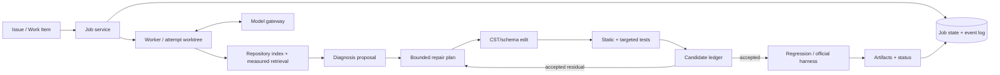

# PatchForge V2 Architecture

## Design principle

Use the simplest system that can preserve evidence, isolate execution, and reject regressions. V2 is a deterministic workflow with model-assisted decisions—not a council of autonomous agents.

## Components and disposition

| Component | Disposition | Responsibility |
|---|---|---|
| Work-item validation | Keep | Normalize input, auth provenance, repository policy. |
| Repository AST/test index | Refactor | Versioned per-base-commit index with retrieval metrics. |
| Temporal/dynamic intelligence | Gate | Experimental signals, enabled only by measured policy. |
| Competing diagnosis | Refactor | Typed hypotheses with explicit evidence/contradiction and confidence provenance. |
| Contract gate | Refactor | Deterministic admissibility checks; never invents behavior. |
| Repair schema | Keep | Model output boundary and audit format. |
| Source reconstruction | Replace | CST-based bounded edits, no speculative auto-import healing without validation. |
| V1 orchestrator | Replace | Pure state reducer + stage workers. |
| SWE-bench adapter | Keep/refactor | Ephemeral runner adapter, no shared forced-clean checkout. |
| Legacy V0/V03 engines | Remove from canonical path | Retain until import/runtime inventory permits deletion. |
| Provider abstraction | Keep | Capability/price/privacy aware model gateway. |
| File episode store | Replace | Job/attempt/event store plus artifact object store. |

## Core contracts

`Job`: immutable input, base revision, tenant, budget, policy.

`Attempt`: job ID, monotonically increasing number, workspace ID, source digest, model/prompt digest, status.

`Hypothesis`: claim, evidence IDs, contradictions, falsifier, candidate sites, confidence provenance.

`RepairPlan`: allowed files/symbols/spans, intended behavior, invariants, actions, justification.

`Candidate`: parent digest, patch digest, changed files, static result, test observations, acceptance decision.

`FailureObservation`: execution phase, test identity, expected/actual, exception/frame summary, environment classification, raw-artifact pointer.

## State machine

`RECEIVED -> PREPARED -> INDEXED -> DIAGNOSED -> PLANNED -> EDITED -> STATIC_VALIDATED -> F2P_VERIFIED -> P2P_VERIFIED -> ACCEPTED | REJECTED | FAILED | CANCELLED`.

Every edge has an idempotency key, timeout, event record, and compensation. `REJECTED` restores the parent candidate workspace; only an explicitly created attempt workspace can be destroyed.

## Model/integration policy

Model calls are bounded by an attempt budget. A provider-independent gateway chooses the configured primary model; an optional cloud escalation occurs only after policy/redaction/budget checks. CLI, REST, GitHub webhook and later tracker adapters all create the same `Job`; they never call the repair engine directly.
