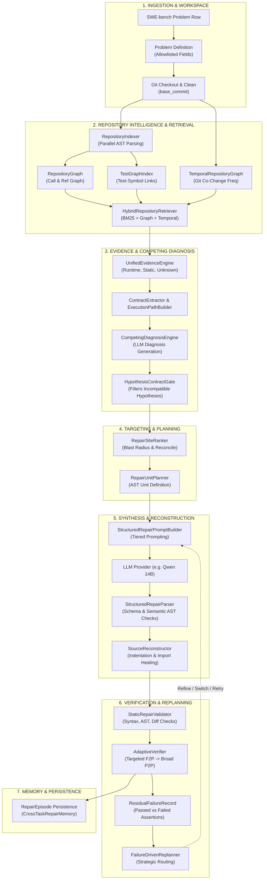
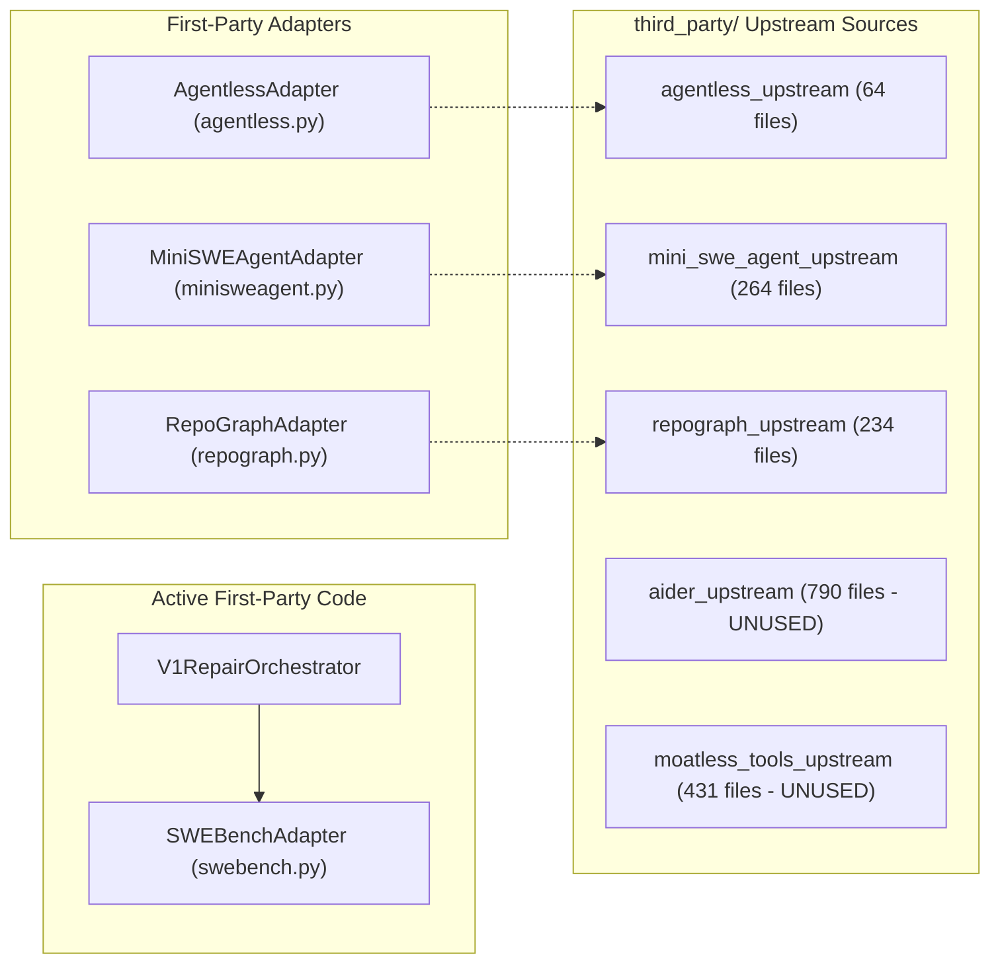

# PatchForge AI — Canonical Architecture Map & Execution Graph (V1.8 Review)

**Document ID**: `DOC-AUDIT-V18-D`  
**Date**: October 12, 2026  
**Scope**: Canonical V1 Pipeline, Shared Subsystems, Legacy Pathways, and Integration Boundaries  

---

## 1. Canonical V1 Architecture Map

The canonical, production execution path for PatchForge AI is centered on `V1RepairOrchestrator` (`patchforge/pipeline/v1_orchestrator.py`), invoked via `scripts/run_v05_cohort.py --engine v1`. 

Below is the end-to-end execution flow, detailing component handoffs, data schemas, and identified disconnects:



---

## 2. Stage-by-Stage Transition Analysis

### Stage 1: Ingestion & Integrity Gating
- **Component**: `Problem.from_dataset_row` (`patchforge/issue/problem.py`).
- **Input**: Raw SWE-bench dataset record.
- **Output**: `Problem` object.
- **Integrity Boundary**: Strictly allowlisted fields (`instance_id`, `repo`, `base_commit`, `version`, `problem_statement`, `hints_text`, `FAIL_TO_PASS`, `PASS_TO_PASS`). Explicitly forbids `patch` and `test_patch`.
- **Status**: Sound.

### Stage 2: Deterministic Repository Intelligence & Indexing
- **Component**: `RepositoryIndexer` (`patchforge/repository_intelligence/indexer.py`).
- **Input**: Clean repository checkout path.
- **Output**: `RepositoryGraph`, `TestGraphIndex`.
- **Cache Fingerprint**: `commit_hash` combined with `git diff HEAD` and recursive content hashes of untracked files (`PF-1.6/1.8`).
- **Identified Gap (`PF-PERF-001`)**: When loading from `.graph.json` cache, test files are re-read and re-parsed synchronously from disk instead of storing test metadata in cache.

### Stage 3: Unified Evidence Packaging & Competing Diagnosis
- **Components**: `UnifiedEvidenceEngine`, `ContractExtractor`, `CompetingDiagnosisEngine`, `HypothesisContractGate`.
- **Data Flow**:
  - `EvidencePackage` strictly segregates `STATIC_CODE_EVIDENCE`, `DYNAMIC_RUNTIME_TRACE`, `PROBLEM_HINT`, and `UNKNOWN_OR_UNAVAILABLE`.
  - Missing dynamic traces are explicitly tagged `UNKNOWN_OR_UNAVAILABLE` rather than hallucinating runtime events.
  - Multi-hypothesis prompt generates competing hypotheses (Hypothesis A, B, etc.).
  - `HypothesisContractGate` tests each hypothesis against extracted `APIContract` and `BehavioralRequirementMatrix`, eliminating hypotheses that break declared parameter constraints.
- **Status**: Sound.

### Stage 4: Repair Site Ranking & Reconciliation
- **Components**: `RepairSiteRanker` (`patchforge/repair/ranking.py`).
- **Data Flow**: Evaluates candidate edit sites from graph analysis, test traces, and diagnosis. Penalizes shared infrastructure helpers (`GLOBAL_INFRASTRUCTURE`) with wide regression radius.
- **Identified Disconnect (`PF-COR-003`)**: `RepairSiteRanker.reconcile_target` checks `clean_file == af_f.split('/')[-1]`. Comparing only basenames can cause false reconciliation across packages sharing common filenames (`requests/models.py` vs `tests/models.py`).

### Stage 5: AST Repair Unit Planning & Structured Synthesis
- **Components**: `RepairUnitPlanner`, `StructuredRepairPromptBuilder`, `StructuredRepairParser`.
- **Data Flow**:
  - `RepairUnitPlanner` defines AST span boundaries (`start_line`, `end_line`, `unit_type`).
  - `StructuredRepairPromptBuilder` constructs JSON-enforcing prompt.
  - `StructuredRepairParser` validates schema (Layer A) and AST category (Layer B).
- **Identified Disconnects**:
  - **`PF-COR-002` (Single-Site Limitation)**: Orchestrator only plans a single `RepairUnit` (`selected_site = ranked_sites[0]`), dropping secondary affected sites identified in diagnosis.
  - **`PF-COR-004` (No-Op Prompt Collapse)**: When a model returns unchanged code, validation rejects it, and tier fallback collapses the prompt to minimal code without surrounding context or invariants, triggering repeated identical no-op rejections across all 3 attempts.
  - **`PF-COR-005` (Line Continuation Corruption)**: Unicode unescaping of JSON strings corrupts trailing backslashes, producing `PATCH_SYNTAX` failures.

### Stage 6: Deterministic Source Reconstruction & Static Validation
- **Components**: `SourceReconstructor` (`patchforge/repair/reconstructor.py`), `StaticRepairValidator`.
- **Data Flow**:
  - Applies surgical replacements into source code preserving indentation and newline conventions.
  - Emits unified diff without LLM diff generation.
  - Auto-heals missing imports. In V1.8 uncommitted changes, built-in symbols (`str`, `bytes`) are guarded to prevent invalid `from _pytest.compat import str` injections.
- **Status**: Functionally verified.

### Stage 7: Adaptive Verification & Failure-Driven Replanning
- **Components**: `AdaptiveVerifier`, `Tester`, `FailureDrivenReplanner`, `ResidualFailureRecord`.
- **Data Flow**:
  - Stage 1: Static syntax/AST check.
  - Stage 2: Targeted `FAIL_TO_PASS` test execution in Docker container.
  - Stage 3: Full `PASS_TO_PASS` regression evaluation if F2P succeeds.
  - Outcomes classified into `FailureClass` (`WRONG_HYPOTHESIS`, `PATCH_SEMANTICS`, `PATCH_SYNTAX`, `REGRESSION`, `UNRESOLVED`).
  - `ResidualFailureRecord` isolates passed vs failed assertions.
- **Identified Critical Defect (`PF-COR-001`)**: In `v1_orchestrator.py` line 1126:
  ```python
  if res_rec.is_partial_progress and getattr(structured_out, "replacement_code", None):
      last_working_replacement = structured_out.replacement_code
  ```
  `StructuredRepairOutput` has `replacement`, NOT `replacement_code`. `last_working_replacement` is always `None`, so partially working code is never passed to attempt 2/3 (`prior_patch_code` is always `None`).

### Stage 8: Cross-Task Memory & Artifact Persistence
- **Component**: `CrossTaskRepairMemory` (`patchforge/memory/store.py`).
- **Data Flow**:
  - Operates in `MemoryMode.FROZEN` during benchmark cohorts: episodes loaded at startup are pinned. Episodes recorded during the run are saved to disk but excluded from the active retrieval pool.
  - Content-addressed memory fingerprint incorporates SHA-256 hashes of all loaded episode files.
- **Status**: Verified.

---

## 3. Parallel, Inactive, and Legacy Pipelines

| Engine / Component | Path | Status | Active Runners | Key Limitations |
| :--- | :--- | :--- | :--- | :--- |
| **`V1RepairOrchestrator`** | `patchforge/pipeline/v1_orchestrator.py` | **CANONICAL ACTIVE** | `scripts/run_v05_cohort.py --engine v1` | Full V1.4-V1.8 feature set. Primary repair target. |
| **`GraphRepairEngine`** | `patchforge/pipeline/graph_engine.py` | Legacy (v0.5) | `scripts/run_v05_cohort.py --engine graph` | Uses old graph-guided search; lacks V1 structured repair and contract gating. |
| **`BaselineRepairEngine`** | `patchforge/pipeline/baseline.py` | Legacy (v0.4) | `scripts/run_v05_cohort.py --engine baseline`, `run_baseline_repair.py`, `run_benchmark.py` | Minimal lexical prompt baseline; used for comparative ablation. |
| **`OrchestratorV03`** | `patchforge/core/orchestrator_v03.py` | Legacy (v0.3) | `scripts/run_single_task_validation.py` | Bounded agentic loop using `AgentController` and SEARCH/REPLACE blocks. |
| **`PatchForgeOrchestrator`** | `patchforge/core/orchestrator.py` | Legacy (v0.1-v0.2) | None (Unreachable) | Initial prototype relying on older upstream integrations. |

---

## 4. Upstream Integration Boundaries



- **Active Boundary**: `SWEBenchAdapter` is actively called by `V1RepairOrchestrator` via `Tester` for official SWE-bench evaluation.
- **Optional / Dormant Boundaries**: `AgentlessAdapter`, `MiniSWEAgentAdapter`, and `RepoGraphAdapter` are imported only by legacy engines (`orchestrator.py`, `orchestrator_v03.py`). Canonical V1 uses first-party implementations (`RepositoryGraph`, `RepairSiteRanker`, `StructuredRepairPromptBuilder`).
- **Unintegrated Dead Code**: `aider_upstream` (790 files) and `moatless_tools_upstream` (431 files) are unreferenced across the entire codebase.
