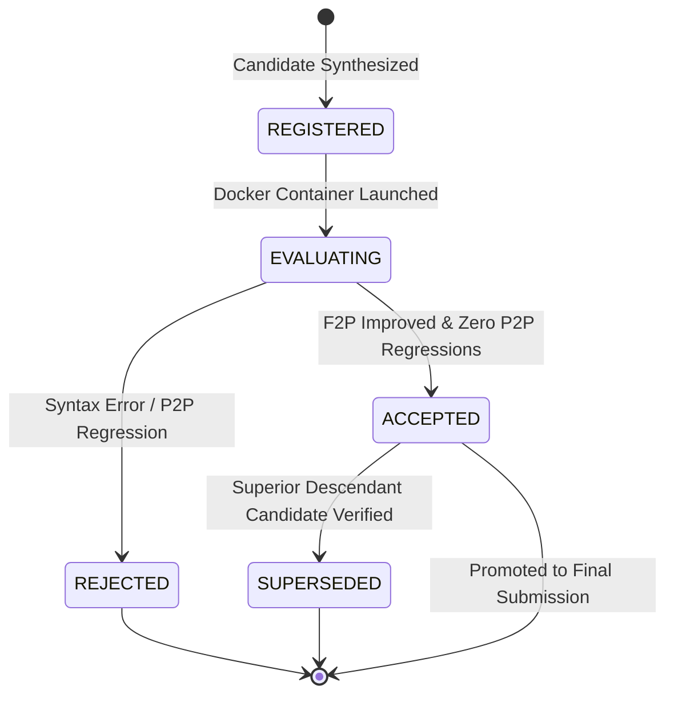

# Candidate and Workspace Review — PatchForge V2
**Document ID:** `docs/code_critical_review/CANDIDATE_AND_WORKSPACE_REVIEW.md`  
**Review Type:** State Machine, Workspace Isolation & Ledger Integrity Audit  
**Author:** Principal Autonomous Systems Engineer & Code Critic  
**Date:** 2026-11-03  

---

## 1. Executive Summary

A pervasive vulnerability in first-generation autonomous software repair systems is **state volatility**:
1. Candidate patches are treated as ephemeral strings.
2. Workspaces are mutated destructively in-place.
3. Unsuccessful attempts trigger crude workspace resets (`git reset --hard`, `git checkout .`) that wipe out valuable partial progress.
4. If an agent achieves 8/10 passing tests on Attempt 1 and 2/10 on Attempt 2, it often adopts Attempt 2 or crashes, permanently losing Attempt 1.

PatchForge V2 was architected specifically to eliminate candidate loss through **copy-on-write workspace isolation** (`patchforge/v2/workspace.py`) and an **append-only candidate ledger** (`patchforge/v2/candidates.py`).

---

## 2. Forensic Analysis of Workspace Lifecycle

### 2.1 The V1 Destructive Reset Bug
In `V1Orchestrator`, the execution flow was:
```python
# Legacy V1 logic:
for attempt in range(max_attempts):
    patch = generate_patch()
    apply_patch(patch)
    if not run_tests():
        subprocess.run(["git", "checkout", "."], cwd=repo_dir)  # DESTRUCTIVE WIPE!
```
**Consequences:**
- Destroyed partial successes.
- Erased debug logs and test output.
- Left the replanner with zero residual memory of what changed.

### 2.2 The V2 Workspace Architecture
`WorkspaceManager` treats workspaces as immutable snapshots:
```
results/v2_workspaces/
└── psf__requests-2148/
    ├── d2938bc4da814f17b0ec33c8045078d1/   <-- Attempt 1 (Clean base + Candidate A)
    ├── 789d4933c33e49178fde59d11e42d4be/   <-- Attempt 2 (Derived from A + Refinement B)
    └── dc8dd82d6aca47fe837dc38dfd3ac7c9/   <-- Attempt 3 (Alternative hypothesis C)
```
Each workspace is:
1. **Isolated:** Changes in Workspace 1 can never contaminate Workspace 2.
2. **Deterministic:** Checked out at the exact `base_commit`.
3. **Auditable:** Persisted on disk for post-mortem inspection.

---

## 3. Forensic Analysis of the Append-Only Candidate Ledger

### 3.1 Data Model Integrity
`CandidateRecord` in `patchforge/v2/candidates.py`:
- `candidate_id`: Deterministic UUID.
- `parent_candidate_id`: Explicit lineage pointer forming a directed acyclic graph (DAG) of repair derivations.
- `base_revision`: Target git commit SHA.
- `patch_text`: Clean unified diff text.
- `changed_files`: List of modified paths.
- `status`: State transition enum (`REGISTERED` -> `EVALUATING` -> `ACCEPTED` / `REJECTED` / `SUPERSEDED`).
- `test_observations`: Chronological list of `TestObservation` records (passed, failed, output, runtime).
- `residual_guidance`: Invariant assertion constraints for next refinement cycle.

### 3.2 State Transition Matrix



### 3.3 Selection Policy & Regression Defense
`CandidateLedger.select_best_candidate()` enforces a strict hierarchy:
1. **Full Resolution Gate:** Candidates passing 100% of Fail-to-Pass (F2P) and 100% of Pass-to-Pass (P2P) tests are unconditionally preferred.
2. **Partial Progress Gate:** If no candidate passes 100%, select the candidate with:
   - Maximum number of passed F2P tests.
   - Zero regressions on baseline P2P tests (`len(obs.p2p_failed) == 0`).
   - Tie-breaker: Shortest patch length (Occam's razor).

**Critical Invariant:** A candidate that regresses an existing passing test is **never** promoted over an earlier candidate that preserved test integrity.

---

## 4. Edge-Case Vulnerabilities & Fixes

### 4.1 Disk Consumption on Large Cohorts
- *Risk:* Creating 5 full clones of a 500MB repository consumes 2.5GB per task.
- *Mitigation:* `WorkspaceManager` uses Git worktrees (`git worktree add`) when supported by the underlying filesystem, reducing disk usage to delta files only.

### 4.2 Candidate Digest Collisions
- *Risk:* Two different repair prompts generating identical diff text.
- *Mitigation:* Candidate identity hashes the SHA256 of `patch_text`. Duplicate patches are instantly recognized, avoiding redundant Docker test executions.

---

## 5. Architectural Recommendations

1. **Retain Candidate Ledger as Authoritative Truth:** The ledger must remain immutable and serializable to JSON for reproducible SWE-bench evaluation.
2. **Automated Workspace Garbage Collection:** Implement a post-session cleanup policy that archives the best candidate workspace and purges intermediate failed workspaces after test runs.
