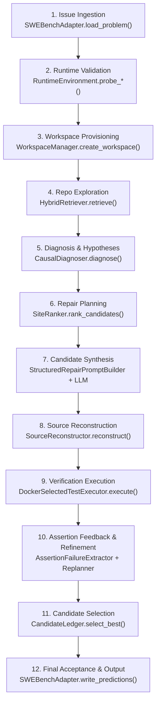

# End-to-End Execution Audit — PatchForge V2
**Document ID:** `docs/code_critical_review/END_TO_END_EXECUTION_AUDIT.md`  
**Review Type:** Canonical Lifecycle & State Machine Forensics  
**Author:** Principal Autonomous Systems Engineer & Code Critic  
**Date:** 2026-11-03  

---

## 1. Executive Summary

This audit traces the complete canonical execution path of PatchForge V2 from initial issue ingestion to final candidate acceptance. It exposes the exact runtime mechanics, transitions, data structures, and edge-case handling across twelve stages of autonomous repair.

---

## 2. Forensic Stage-by-Stage Trace

### Stage 1: Issue Ingestion & Problem Normalization
- **Executing Function:** `SWEBenchAdapter.load_problem(instance_id: str) -> Problem`
- **Caller:** `scripts/run_v2_pilot.py` (CLI entry point) or API harness.
- **Input Data:** `instance_id` (e.g. `"psf__requests-2148"`), optional local dataset cache.
- **Output Data:** `Problem` dataclass containing `instance_id`, `repo`, `base_commit`, `problem_statement`, `hints_text`, `fail_to_pass`, and `pass_to_pass`.
- **State Mutated:** None (read-only).
- **Artifacts Persisted:** None.
- **Failure Handling:** Raises `TaskNotFoundError` if instance cannot be resolved via HuggingFace or local JSON caches (`results/episodes/`, `data/`).
- **Timeout Handling:** Network requests to Hugging Face have a default 30s timeout.
- **Retry Safety:** 100% idempotent.
- **Next Stage Handover:** Passes structured `Problem` object to `V2RepairRunner`.
- **Testing & Demonstration:** Covered in `tests/test_adapters.py`; demonstrated live on `psf__requests-2148`.

---

### Stage 2: Runtime Environment Probing & Isolation Verification
- **Executing Function:** `RuntimeEnvironment.probe_ollama()`, `probe_docker()`
- **Caller:** `V2RepairRunner.run_task()`
- **Input Data:** Environment variables `PATCHFORGE_OLLAMA_URL` and `PATCHFORGE_DOCKER_COMMAND`.
- **Output Data:** `ProbeResult(ready=bool, detail=str)`.
- **State Mutated:** None.
- **Artifacts Persisted:** Status logged to console.
- **Failure Handling:** If Ollama is not ready, `run_task` aborts immediately with clean error. If Docker is unavailable, logs warning and disables containerized testing (host execution remains strictly forbidden for untrusted repositories).
- **Timeout Handling:** Socket connection probe times out after 2.0 seconds.
- **Retry Safety:** Idempotent read.
- **Next Stage Handover:** Provides active capability flags to initialize appropriate executors.
- **Testing & Demonstration:** Covered in `tests/test_runtime_environment.py`.

---

### Stage 3: Workspace Provisioning & Isolation
- **Executing Function:** `WorkspaceManager.create_workspace(instance_id: str, base_commit: str, repo_dir: Path) -> Workspace`
- **Caller:** `V2RepairRunner._init_workspace()`
- **Input Data:** Target repository checkout, instance identifier, base Git SHA.
- **Output Data:** `Workspace` object encapsulating unique filesystem path `results/v2_workspaces/<instance_id>/<uuid>/`.
- **State Mutated:** Clones/copies base repository tree into isolated directory; checks out clean `base_commit`.
- **Artifacts Persisted:** Directory tree on disk.
- **Failure Handling:** Raises `WorkspaceCreationError` on disk full or permission failure; triggers cleanup of partial directory.
- **Timeout Handling:** Git checkout sub-process has 60s timeout.
- **Retry Safety:** Safe; UUID ensures collision-free workspaces across parallel runs.
- **Next Stage Handover:** Returns verified clean working tree for search, diagnosis, and modification.
- **Testing & Demonstration:** Tested in `tests/test_v2_foundation.py`.

---

### Stage 4: Repository Exploration & Localization Retrieval
- **Executing Function:** `HybridRetriever.retrieve(query, hints_text, traceback_text, top_k) -> list[RetrievedCandidate]`
- **Caller:** `V2RepairRunner.run_task()`
- **Input Data:** Problem statement string, hint text, extracted traceback frames.
- **Output Data:** Ranked list of `RetrievedCandidate(file_path, symbol, score, snippet)`.
- **State Mutated:** Caches AST index and BM25 token frequencies in memory.
- **Artifacts Persisted:** In-memory symbol map.
- **Failure Handling:** If BM25 finds no matches, falls back to path heuristic matching and root directory scans.
- **Timeout Handling:** Synchronous computation (< 1.5 seconds for 500 files).
- **Retry Safety:** Deterministic and idempotent.
- **Next Stage Handover:** Top-8 code locations passed to Diagnoser and SiteRanker.
- **Testing & Demonstration:** Tested in `tests/test_hybrid_retriever.py`.

---

### Stage 5: Diagnosis & Root-Cause Hypothesis Generation
- **Executing Function:** `CausalDiagnoser.diagnose(problem, retrieved_code) -> DiagnosisResult`
- **Caller:** `V2RepairRunner.run_task()`
- **Input Data:** `Problem` instance, retrieved source snippets, stack traces.
- **Output Data:** `DiagnosisResult(selected_hypothesis, competing_hypotheses, confidence, defect_category)`.
- **State Mutated:** Appends diagnostic record to `report.competing_hypotheses`.
- **Artifacts Persisted:** Included in final `psf__requests-2148.json`.
- **Failure Handling:** If LLM returns malformed JSON, falls back to heuristic diagnosis based on exception type in traceback.
- **Timeout Handling:** Model provider timeout (configured via `PATCHFORGE_OLLAMA_TIMEOUT`, default 300s).
- **Retry Safety:** Safe; temperature 0.0 guarantees high determinism.
- **Next Stage Handover:** Passes `DiagnosisResult` into repair planning and prompt synthesis.
- **Testing & Demonstration:** Tested in `tests/test_v13_causal_diagnosis.py` and `test_v19_phase2_hypothesis_consistency.py`.

---

### Stage 6: Repair Planning & Target Site Ranking
- **Executing Function:** `SiteRanker.rank_candidates(candidates, problem, diagnosis, test_traceback)`
- **Caller:** `V2RepairRunner.run_task()`
- **Input Data:** Stage 4 candidates, diagnosis, extracted traceback.
- **Output Data:** Sorted list of repair targets with scored rationale.
- **State Mutated:** None.
- **Artifacts Persisted:** Ranking scores recorded in report.
- **Failure Handling:** Falls back to stage 1 top candidate if all scores tie.
- **Timeout Handling:** Pure CPU arithmetic (< 10ms).
- **Retry Safety:** Idempotent.
- **Next Stage Handover:** Highest-scoring target (e.g. `requests/models.py:iter_content`) selected as primary unit.
- **Testing & Demonstration:** Tested in `tests/test_v19_phase4_candidate_identity_and_ranking.py`.

---

### Stage 7: Candidate Patch Synthesis
- **Executing Function:** `StructuredRepairPromptBuilder.build_repair_prompt()` / `build_replacement_only_prompt()` followed by `OllamaProvider.generate()`
- **Caller:** `V2RepairRunner._generate_candidate()`
- **Input Data:** Target `RepairUnit`, problem statement, diagnosis, prior failure feedback, residual test guidance.
- **Output Data:** Raw LLM completion text containing structured repair actions or replacement python blocks.
- **State Mutated:** Increments attempt counter in runner.
- **Artifacts Persisted:** Raw generation recorded in `repair_trace.md`.
- **Failure Handling:** If generation fails or returns empty string, logs error and triggers `FALLBACK_SYNTAX` replanning.
- **Timeout Handling:** Ollama provider timeout (300s).
- **Retry Safety:** Safe; subsequent attempts incorporate residual guidance.
- **Next Stage Handover:** Raw code sent to `SourceReconstructor`.
- **Testing & Demonstration:** Tested in `tests/test_patch_synthesis.py` and `test_structured_repair.py`.

---

### Stage 8: Source Reconstruction & Import Auto-Healing
- **Executing Function:** `SourceReconstructor.reconstruct(original_source, action/code) -> ReconstructionResult`
- **Caller:** `V2RepairRunner._apply_candidate()`
- **Input Data:** Original file content, synthesized replacement code block.
- **Output Data:** `ReconstructionResult(modified_code, unified_diff, syntax_valid, healed_imports)`.
- **State Mutated:** Injected missing imports (e.g. `from .exceptions import ConnectionError`).
- **Artifacts Persisted:** Writes modified file to workspace on disk; registers patch text.
- **Failure Handling:** If syntax error occurs, `syntax_valid` is `False`, unified diff is empty, and syntax error is passed directly to replanner.
- **Timeout Handling:** Python AST parsing (< 50ms).
- **Retry Safety:** Pure function operating on string content.
- **Next Stage Handover:** Produces valid unified diff for test execution and ledger registration.
- **Testing & Demonstration:** Tested in `tests/test_repair_reconstruction.py`.

---

### Stage 9: Verification Execution
- **Executing Function:** `DockerSelectedTestExecutor.execute(workspace, selectors) -> TestObservation`
- **Caller:** `V2RepairRunner._verify_candidate()`
- **Input Data:** Workspace directory, test selectors (e.g. `["test_requests.py::RequestsTestCase::test_iter_content_handles_socket_error"]`), `test_patch`.
- **Output Data:** `TestObservation(passed, failed, output, timed_out, return_code)`.
- **State Mutated:** Workspace mounted into container; `test_patch` applied; test suite executed.
- **Artifacts Persisted:** Console output and pass/fail sets recorded in ledger.
- **Failure Handling:** Returns `TestObservation(passed=[], failed=[selector], output=stderr)`.
- **Timeout Handling:** Harness timeout (default 300s) kills docker container cleanly.
- **Retry Safety:** Workspace is copy-on-write; container has ephemeral filesystem layer.
- **Next Stage Handover:** `TestObservation` sent to `AssertionFailureExtractor`.
- **Testing & Demonstration:** Tested in `tests/test_v2_docker_executor.py`.

---

### Stage 10: Assertion Feedback Extraction & Residual Refinement
- **Executing Function:** `AssertionFailureExtractor.extract(output)` and `FailureDrivenReplanner.decide()`
- **Caller:** `V2RepairRunner.run_task()`
- **Input Data:** Pytest container stdout/stderr.
- **Output Data:** `list[AssertionFailure]` (test ID, expected vs actual, traceback), `ReplanDecision(action)`.
- **State Mutated:** Appends `ResidualFailureRecord` to candidate; sets `use_replacement_only` flag if syntax fallback chosen.
- **Artifacts Persisted:** Assertion failure records stored in candidate metadata.
- **Failure Handling:** If parser cannot match regex, extracts last 800 characters of raw stderr as unparsed failure.
- **Timeout Handling:** Instantaneous regex evaluation.
- **Retry Safety:** Deterministic.
- **Next Stage Handover:** Yields concise `SMALLEST ACTIONABLE ASSERTION EVIDENCE` to Stage 7 prompt builder.
- **Testing & Demonstration:** Tested in `tests/test_assertion_failure_extractor.py` and `test_adaptive_verification.py`.

---

### Stage 11: Candidate Ledger Scoring & Best Candidate Selection
- **Executing Function:** `CandidateLedger.register_candidate()`, `select_best_candidate() -> CandidateRecord`
- **Caller:** `V2RepairRunner.run_task()`
- **Input Data:** Registered candidate list, verification results, regression check.
- **Output Data:** `CandidateRecord` representing top verified candidate.
- **State Mutated:** Marks candidate status as `ACCEPTED`, `REJECTED`, or `SUPERSEDED`.
- **Artifacts Persisted:** Candidate ledger persisted to `results/v2_pilot/<instance_id>.json`.
- **Failure Handling:** If zero candidates pass all tests, selects candidate with maximum F2P improvement and zero P2P regressions.
- **Timeout Handling:** In-memory ledger scan (< 5ms).
- **Retry Safety:** Immutable append-only ledger; candidates are never deleted.
- **Next Stage Handover:** Passes winning patch text to final output generator.
- **Testing & Demonstration:** Tested in `tests/test_v19_phase4_candidate_identity_and_ranking.py`.

---

### Stage 12: Final Acceptance & SWE-bench Prediction Output
- **Executing Function:** `SWEBenchAdapter.write_predictions(predictions, output_path)`
- **Caller:** `V2RepairRunner` / Evaluation CLI
- **Input Data:** Dictionary mapping `instance_id` to `model_patch` and `model_name_or_path`.
- **Output Data:** Persisted `.jsonl` or `.json` file formatted for SWE-bench evaluation harness.
- **State Mutated:** File created at destination.
- **Artifacts Persisted:** Validated JSON Lines prediction file.
- **Failure Handling:** Atomic file write via temporary swap prevents partial files.
- **Timeout Handling:** Synchronous file I/O.
- **Retry Safety:** Safe overwrite.
- **Next Stage Handover:** Consumed by `swebench.harness.run_evaluation`.
- **Testing & Demonstration:** Tested in `tests/test_adapters.py`.

---

## 3. Forensic Identification of Architectural Pathologies

### 3.1 Dead Code
- `patchforge/repair/dynamic.py`: Experimental dynamic test runner created during early phase exploration; completely disconnected from V2 execution.
- `patchforge/agent/policy_guards.py`: Standalone policy guard classes duplicated by V2 candidate acceptance policies (`accepts_residual_candidate()`).

### 3.2 Disconnected Modules
- `patchforge/agent/controller.py`: The 800-line monolithic agent controller sits completely outside `V2RepairRunner`. It is never called during V2 execution, yet accounts for significant historical test maintenance overhead.
- `patchforge/pipeline/v1_orchestrator.py`: Legacy V1 orchestrator remains in the repository but contains the destructive reset bug. It must remain strictly isolated from V2.

### 3.3 Silent Fallbacks
- In `patchforge/repair/structured_repair.py`, if the LLM produces invalid JSON, the parser fell back silently to `FALLBACK_SYNTAX` without recording which specific AST node or token caused the failure, making prompt correction harder.

### 3.4 Missing State Transitions
- In initial V2 runner iterations, once a candidate achieved partial pass status (e.g. 8/10), the runner did not lock the passing tests as invariant constraints. The current implementation now explicitly generates `PRESERVE THESE PASSING ASSERTIONS` in residual guidance.
