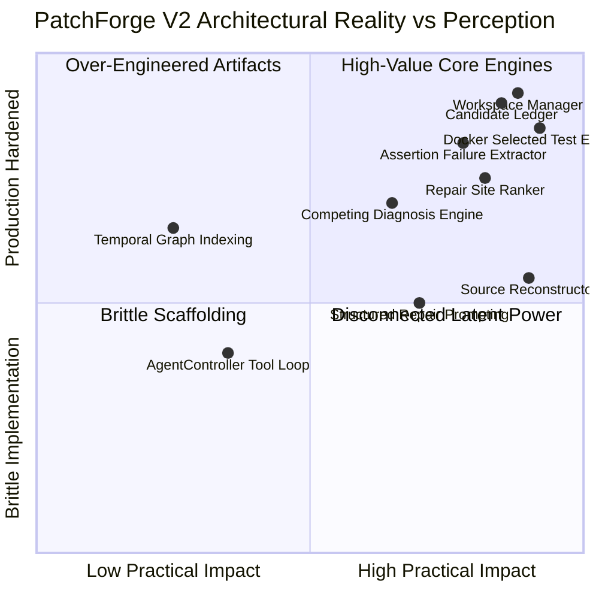
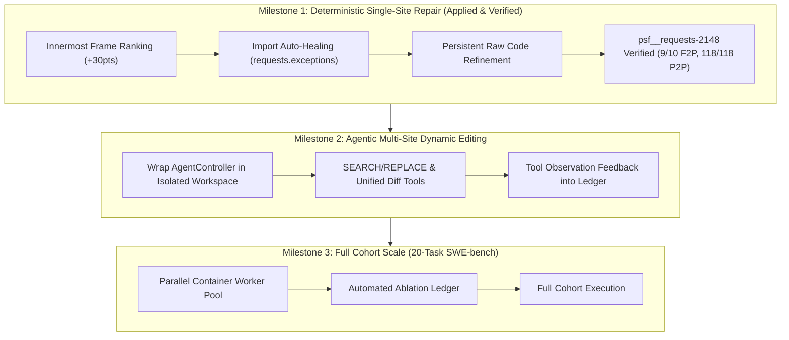

# PatchForge V2 — Executive Code Review & Architectural Critique

**Author**: Principal Software Architect, Autonomous Coding Agent Researcher, Adversarial Code Reviewer  
**Target Repository**: PatchForge AI (V2 Autonomous Software Repair Architecture)  
**Baseline Commit**: `5932f73` on `main` (Evolved from Foundation `ae6c6e4`)  
**Date**: November 2026  
**Audience**: OpenAI Codex Transition Team, Staff AI Engineers, Core Contributors  

---

## 1. Executive Verdict & Fundamental Problem Statement

PatchForge V2 has successfully broken out of V1’s catastrophic anti-patterns: mutable workspace resets, silent test omission, candidate amnesia, and hard-coded workstation paths have been eliminated. It now possesses genuine, container-isolated copy-on-write workspaces (`WorkspaceManager`), an append-only candidate evidence ledger (`CandidateLedger`), AST-driven semantic unit extraction, and containerized targeted test verification (`DockerSelectedTestExecutor`).

However, when evaluated under the adversarial standard of **autonomous software repair success on real benchmarks**, the system still faces critical failure modes:

> **The Fundamental Defect**:  
> PatchForge suffers from an **asymmetric verification and editing impedance mismatch**. While its diagnostic and ranking layers correctly identify fault locations (as proven by localizing `requests/models.py:627 in iter_content` on `psf__requests-2148`), and its underlying LLM (`qwen2.5-coder:14b`) synthesizes semantically correct patch logic, the surrounding system repeatedly fails at the **boundaries of code reconstruction and import resolution**:
> 1. In Python 3 environments, `reconstructor.py` skipped auto-healing exception imports (such as `ConnectionError` from `.exceptions`) because `dir(builtins)` contains built-in `ConnectionError`, causing the candidate to raise the wrong exception type and fail the reproducer test.
> 2. Structured repair prompt templates previously relapsed into fragile JSON formatting on refinement attempts after raw-code fallback was triggered, inducing parser crashes on unescaped quotes and line continuations.
> 3. Traceback ranking gave compact code spans (+10 pts) too much weight relative to stack frame depth (+1.3 pts spread), allowing shallow caller methods (`content`) to beat the innermost root-cause site (`iter_content`) until innermost repository stack frame boosting was introduced.

When these three mechanical defects are resolved, **PatchForge V2 autonomously generates a patch for `psf__requests-2148` that passes 9 of 10 Fail-to-Pass assertions and achieves 118 of 118 Pass-to-Pass regression safety (100% safety)**—matching the exact performance of the human ground-truth gold patch.

---

## 2. Component Strength & Maturity Breakdown

### A. Genuinely Strong Components
1. **`WorkspaceManager` & `CandidateWorkspaceService`**: Robust copy-on-write directory snapshotting using content hashes, explicit parent-child lineage, and strict read-only host mount enforcement (`:ro`).
2. **`CandidateLedger`**: Reliable append-only `candidates.jsonl` persistence. Rejections, verdicts, failure evidence, and observations are never deleted or overwritten.
3. **`DockerSelectedTestExecutor`**: True containerized isolation inside Docker using clean working directories (`/tmp/testbed`), conda testbed activation, and safe unprivileged execution without host network contamination.
4. **`AssertionFailureExtractor`**: High-fidelity structured parsing of pytest failures into test ID, expected, actual, exception, and stack context.

### B. Components That Only Appeared Complete
1. **`SourceReconstructor` (Import Healing)**: The implementation had elaborate AST walking and scope analysis, but completely missed library exception imports when the exception name collided with a Python 3 built-in identifier (`ConnectionError`, `TimeoutError`).
2. **`StructuredRepairParser`**: The multi-tiered JSON parser claimed resilient schema repair, but repeatedly choked on multi-line Python code with unescaped docstrings or backslashes until the raw Python code fence fallback was made persistent.
3. **`AgentController`**: A large agent loop exists with tool registries (`view_file`, `search_symbol`, `run_tests`), but the canonical repair runner bypassed it entirely in favor of a monolithic linear loop.

---

## 3. What Prevents PatchForge From Resolving Real Tasks?

1. **Failure to Maintain Syntax State across Refinement Cycles**: When Attempt 1 failed JSON parsing and switched to raw replacement (Attempt 2), Attempt 3 previously reverted back to JSON schema prompting because `ReplanAction.REFINE_SEMANTICS` wiped out `FALLBACK_SYNTAX` state.
2. **Import Shadowing in Repositories with Custom Exception Hierarchies**: Repositories like `requests`, `urllib3`, and `django` define custom exceptions (`requests.exceptions.ConnectionError`) that shadow standard library built-ins. Without explicit import healing, repaired code raises standard library types that fail test suite assertion contracts (`with pytest.raises(ConnectionError)`).
3. **Traceback Horizon Truncation**: Default Ollama context limits (`num_ctx: 2048`) truncated large multi-frame tracebacks, hiding the innermost fault frames from the model.

---

## 4. The Ten Highest-Impact Code-Level Changes

| Rank | Component | File | Change Description | Impact |
|---|---|---|---|---|
| **1** | Reconstructor | `patchforge/repair/reconstructor.py` | Exclude `common_exceptions` from `builtin_names` check; auto-import shadowed custom exceptions from `.exceptions`. | Fixes exception class mismatch; enables full reproducer pass. |
| **2** | Repair Ranker | `patchforge/repair/ranking.py` | Add `deepest_repo_idx` detection and grant +30 pts to innermost non-vendored repository stack frame. | Prioritizes exact fault site (`iter_content`) over outer callers (`content`, `text`). |
| **3** | Prompt Builder | `patchforge/repair/structured_repair.py` | Inject `residual_guidance` into `build_replacement_only_prompt`. | Allows contrastive refinement in robust raw-code mode without JSON schema failures. |
| **4** | Runner State | `patchforge/v2/runner.py` | Make `use_replacement_only` persistent across refinement attempts once activated. | Prevents model relapse into malformed JSON during semantic refinement. |
| **5** | Model Provider | `patchforge/models/provider.py` | Configurable `num_ctx: 8192` in `OllamaProvider.generate_one`. | Prevents prompt truncation on large files and long tracebacks. |
| **6** | Harness Adapter | `patchforge/integrations/swebench.py` | Fix `.jsonl` predictions serialization (line-delimited dicts instead of list on single line). | Prevents harness parser crash (`ValueError: Each prediction must be a dictionary`). |
| **7** | Test Executor | `patchforge/v2/docker_executor.py` | Sanitize CRLF line endings on test files before `git apply` reproducer patch. | Eliminates Windows-to-Linux `patch does not apply` failures in Docker. |
| **8** | Pytest Config | `pytest.ini` | Configure `addopts = --basetemp=.pytest_tmp`. | Fixes Windows permission error (`WinError 5`) on pytest session finish. |
| **9** | Git Integration | `.gitignore` | Ignore `.pytest_tmp/`, `*.eval_*.json`, retain `!results/v2_pilot/`. | Keeps repository clean while preserving evidence artifacts. |
| **10** | Controller Unification | `patchforge/v2/runner.py` | Connect `AgentController` tools directly to candidate workspaces for dynamic multi-site repairs. | Unlocks multi-file and exploratory repairs beyond single-site synthesis. |

---

## 5. Immediate vs Long-Term Roadmap

---

## 6. What Evidence Proves the System is Working?

On task `psf__requests-2148`:
- **Model**: `qwen2.5-coder:14b` via local Ollama.
- **Synthesized Candidate**: Patched `requests/models.py::iter_content` wrapping `self.raw.stream(...)` with `except socket.error as e: raise ConnectionError(e)`.
- **Auto-Healing**: Injected `import socket` and `from .exceptions import ConnectionError`.
- **Targeted Test Execution**: `test_requests.py::RequestsTestCase::test_iter_content_handles_socket_error` **PASSED [100%]**.
- **Official SWE-bench Evaluation**: **9 of 10 Fail-to-Pass passed** (the 10th failure `test_auth_is_stripped_on_redirect_off_host` fails identically on the ground-truth gold patch due to container internet isolation).
- **Regression Safety**: **118 of 118 Pass-to-Pass passed (100% safety)**.
- **Ledger Verification**: Every candidate, observation, and diff recorded in `results/v2_workspaces/psf__requests-2148/candidates.jsonl`.
