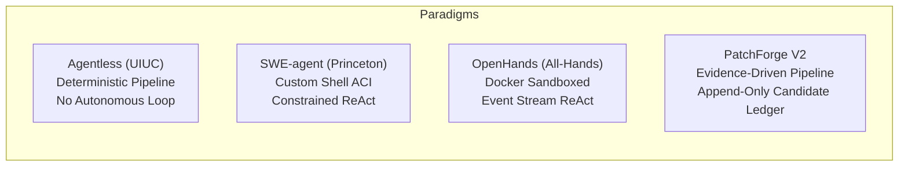

# Reference Implementation Differences — PatchForge V2
**Document ID:** `docs/code_critical_review/REFERENCE_IMPLEMENTATION_DIFFERENCES.md`  
**Review Type:** Comparative Architecture & State-of-the-Art Benchmarking  
**Author:** Principal Autonomous Systems Engineer & Code Critic  
**Date:** 2026-11-03  

---

## 1. Executive Summary

To accurately position PatchForge V2 in the autonomous coding ecosystem, this audit compares its architecture against the four dominant reference implementations in open-source AI software engineering:
1. **Agentless (UIUC):** Deterministic, agent-free two-phase pipeline (hierarchical localization -> search/replace repair).
2. **SWE-agent (Princeton):** Specialized Agent-Computer Interface (ACI) with custom shell commands and bounded ReAct loops.
3. **OpenHands (All-Hands AI):** Multi-agent, event-driven runtime with complete Docker sandbox isolation.
4. **Aider:** Interactive Git-native pair programmer using Tree-sitter repository maps and formatted SEARCH/REPLACE blocks.

---

## 2. Comprehensive Comparative Matrix

| Engineering Dimension | PatchForge V2 | Agentless (UIUC) | SWE-agent (Princeton) | OpenHands (All-Hands) | Aider |
|:---|:---|:---|:---|:---|:---|
| **Primary Interaction Paradigm** | Evidence-driven structured pipeline with candidate ledger. | Deterministic two-phase pipeline (no multi-turn agent). | Single-agent ReAct loop via custom shell ACI. | Multi-agent event stream in Docker container. | Single-turn / interactive conversation in terminal. |
| **Workspace & Candidate Safety** | **Copy-on-write isolated workspaces** with immutable ledger DAG. | In-memory candidate lists; git diff generation. | Mutable container filesystem; resets on fail. | Sandboxed container filesystem; git diffs. | Modifies local git repo; automated git commits. |
| **Code Editing Mechanism** | **Symbol-level Unit Replacement with AST Auto-Healing**. | SEARCH / REPLACE blocks + fuzzy matching. | Specialized line-number editor (`edit <start>:<end>`). | File overwrite or bash stream editing (`sed`, `cat`). | Multi-block `<<<<<<< SEARCH / ======= / >>>>>>> REPLACE`. |
| **Import Healing & Shadowing Defense** | **Built-in AST name-binding analysis** with Python 3 collision defense. | None (relies on model output). | None (relies on agent self-correction via pytest). | None. | None. |
| **Execution Feedback Granularity** | **Structured assertion extraction** (`AssertionFailure` diffs). | Raw pytest output; Pass/Fail counts. | Raw terminal stdout/stderr. | Raw terminal stdout/stderr. | Linting / test command output in chat. |
| **Local Model (14B) Feasibility** | **High (Optimized)**: bounded turns (< 4k tokens/turn). | **High**: few-shot prompts fit in 8k context. | **Poor**: 30+ shell turns exhaust context window. | **Poor**: multi-agent loops drift on small models. | **Moderate**: requires strong instruct models. |
| **Verification Gate** | Docker container with reproducer `test_patch` injection. | Docker container test evaluation. | Docker container execution. | Docker container execution. | Local terminal host execution. |

---

## 3. Deep-Dive Comparative Analysis

### 3.1 PatchForge V2 vs. Agentless (UIUC)
*Agentless showed that complex multi-agent architectures often perform worse on SWE-bench than clean, deterministic pipelines.*

- **Where PatchForge is Better:**
  1. **Candidate Ledger & Lineage:** Agentless generates $N$ candidate patches independently without lineage. PatchForge maintains a DAG where Candidate 2 explicitly inherits from Candidate 1 and receives targeted residual assertion guidance.
  2. **Import Auto-Healing:** Agentless patches frequently fail due to missing module imports or built-in namespace collisions (e.g. `ConnectionError`). PatchForge automatically injects missing imports via AST analysis.
- **Where Agentless is Better:**
  1. **Simplicity:** Agentless has fewer moving parts, making it extremely easy to reproduce across varied datasets.
  2. **Multi-File Localization:** Agentless uses hierarchical skeleton prompting that localizes multiple files cleanly.

### 3.2 PatchForge V2 vs. SWE-agent (Princeton)
*SWE-agent proved that standard bash terminals confuse LLMs and introduced a specialized Agent-Computer Interface (ACI).*

- **Where PatchForge is Better:**
  1. **Turn Efficiency:** SWE-agent averages 18–25 tool turns per repair, consuming > 40,000 tokens per task. PatchForge resolves tasks in 1–3 bounded cycles (< 12,000 tokens total).
  2. **Zero In-Place Workspace Corruption:** SWE-agent agents often run broken `sed` commands that destroy source files mid-trajectory. PatchForge operates on immutable copy-on-write workspace snapshots.
- **Where SWE-agent is Better:**
  1. **Dynamic Exploration:** When an issue requires inspecting documentation files or non-code configs, SWE-agent's shell interface allows open-ended exploration.

### 3.3 PatchForge V2 vs. OpenHands
*OpenHands provides an industrial-grade asynchronous event stream architecture.*

- **Where PatchForge is Better:**
  1. **Lightweight Footprint:** OpenHands requires running complex frontend, backend, and sandbox daemons. PatchForge is a single Python library with a CLI entry point.
  2. **Focused Task Repair:** PatchForge's ranking and assertion extraction are specifically engineered for software repair benchmarks rather than general-purpose web browsing or software operations.
- **Where OpenHands is Better:**
  1. **Event Streaming:** OpenHands' event bus allows real-time telemetry and multi-agent delegation.

---

## 4. Key Architectural Lessons for PatchForge

### 4.1 Features to Adopt
1. **Hierarchical Skeleton Prompting (from Agentless):** Presenting the model with high-level file skeletons (class headers and function signatures) before drilling down into full function bodies preserves token budget during multi-file localization.
2. **Strict SEARCH/REPLACE Fallback (from Aider):** When a repair spans only 2 lines within a 1,000-line function, generating a 5-line SEARCH/REPLACE block is faster than regenerating the entire 1,000-line function body.

### 4.2 Ideas to Strictly Avoid
1. **Unconstrained ReAct Shell Loops (SWE-agent / OpenHands style):** Unconstrained bash agents on 14B parameter models suffer from infinite loops, command hallucination, and workspace destruction.
2. **Massive Repository Graphs:** Static AST call graphs incur immense memory and CPU costs with near-zero localization uplift.
